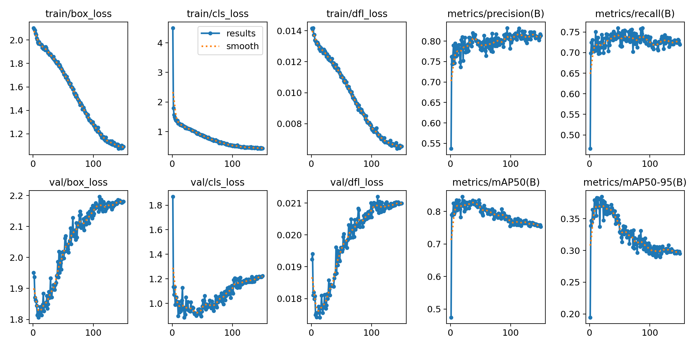
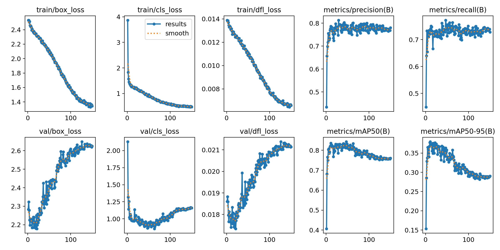

# Comparación de cuatro modelos: 150 épocas completas

La campaña de opciones 3 y 4 terminó el 22 de octubre de 2026 a las 05:48:58, hora de Ciudad de México. Ambos entrenamientos completaron exactamente las épocas 1 a 150 y terminaron sus evaluaciones principales y cruzadas. Se conservaron los resultados de las dos corridas anteriores.

Las figuras y archivos ligeros enlazados se incluyen como [copias para redacción](resultados/README.md), disponibles al clonar el repositorio. Los checkpoints, datasets y salidas completas permanecen en la computadora de cálculo.

## Resultado principal: misma evaluación a 640 píxeles

La tabla está ordenada por mAP50-95 de prueba. Todos los modelos usan el mismo conjunto de 136 imágenes de prueba, con 1115 agaves anotados, y el mismo protocolo de evaluación a 640. Los valores son porcentajes. Corresponden a `best.pt`, elegido mediante validación, no al checkpoint de la época 150.

| Orden | Configuración entrenada | Épocas realizadas | Mejor época | Precisión | Recall | mAP50 | mAP50-95 |
|---|---|---:|---:|---:|---:|---:|---:|
| 1 | YOLO26s + SGD, 640, box=7.5 (referencia) | 150 | 23 | 68.20 | 62.52 | 66.55 | 24.32 |
| 2 | YOLO26s + SGD, 640, box=9.0 | 150 | 11 | 70.07 | 62.06 | 68.34 | 24.27 |
| 3 | YOLO26n + AdamW, 640, aumentos de campo | 150 | 48 | 67.63 | 51.71 | 58.61 | 22.23 |
| 4 | YOLO26s + SGD, entrenado a 960 y evaluado a 640 | 150 | 20 | 64.91 | 52.47 | 57.69 | 20.94 |

`box=9.0` mejora la precisión en 1.86 puntos porcentuales y mAP50 en 1.79 puntos respecto a la referencia, pero pierde 0.45 puntos de recall y 0.057 puntos de mAP50-95. Sus resultados de mAP50-95 son muy cercanos; esta corrida no demuestra una mejora consistente del ajuste de cajas. La referencia también conserva mayor mAP50-95 de validación a 640: 38.33% frente a 37.94% del modelo con box=9.0.

El modelo entrenado a 960 queda último al evaluarlo a 640. Eso no describe su rendimiento a su resolución de entrenamiento; se presenta a continuación por separado.

## Comparación cruzada de resolución

Se evaluó el mismo `best.pt` de cada corrida a ambas resoluciones. `selection_imgsz` es la resolución usada para elegir el checkpoint mediante validación durante entrenamiento; `evaluation_imgsz` es la utilizada en esta evaluación. En estas corridas, la resolución de selección coincide con la de entrenamiento.

| Entrenamiento / selection_imgsz | evaluation_imgsz | Mejor época | Precisión test | Recall test | mAP50 test | mAP50-95 test |
|---:|---:|---:|---:|---:|---:|---:|
| 640 | 640 | 23 | 68.20 | 62.52 | 66.55 | 24.32 |
| 640 | 960 | 23 | 64.08 | 62.06 | 65.53 | 22.36 |
| 960 | 640 | 20 | 64.91 | 52.47 | 57.69 | 20.94 |
| 960 | 960 | 20 | 67.89 | 60.63 | 66.98 | 24.67 |

Entrenar y evaluar a 960 da el mayor mAP50-95 observado: 24.67%. La ventaja frente a entrenar y evaluar a 640 es de solo 0.35 puntos porcentuales y su recall es 1.89 puntos menor. En validación, esas dos combinaciones dieron 38.49% y 38.33% de mAP50-95, respectivamente. Una única corrida por configuración y este test no permiten afirmar una mejora estadísticamente estable.

A resolución de evaluación común de 960, el modelo entrenado a 960 supera al control entrenado a 640 en 2.31 puntos de mAP50-95. Subir únicamente la resolución de inferencia del control no mejoró su resultado. Los resultados justifican distinguir ambos cambios y conservar las tablas separadas.

El checkpoint seleccionado por validación a 960 no necesariamente es el mejor checkpoint de esa corrida para inferencia a 640. No se utilizó el conjunto de prueba para escoger épocas ni checkpoints. Esta limitación debe conservarse al describir la comparación.

## Curvas y sobreajuste

Los valores siguientes son de validación registrada durante entrenamiento, a la resolución de cada corrida; no son métricas de prueba ni la reevaluación independiente posterior de `best.pt`.

| Configuración nueva | Mejor época | Mejor mAP50-95 val | mAP50-95 val en época 150 | Caída en puntos porcentuales |
|---|---:|---:|---:|---:|
| YOLO26s + SGD, 960 | 20 | 38.47% | 29.50% | 8.96 |
| YOLO26s + SGD, 640, box=9.0 | 11 | 37.95% | 29.03% | 8.93 |

Ambos muestran señales sostenidas de sobreajuste: las pérdidas de entrenamiento bajan mientras las de validación suben y su mAP cae. En la corrida de 960, desde la mejor época hasta la 150, `train/box_loss` baja de 1.913 a 1.090 y `val/box_loss` sube de 1.850 a 2.180. En la corrida con box=9.0 ocurre de 2.393 a 1.344 y de 2.212 a 2.625, respectivamente. Estas son comparaciones dentro de cada corrida: el cambio de ponderación impide comparar directamente la magnitud de la pérdida de cajas de box=9.0 contra box=7.5.

Las 150 épocas completas permiten documentar esta evolución. Se guardaron `best.pt` y `last.pt`; las tablas finales de prueba usan `best.pt`. No se ha hecho una evaluación de prueba adicional de `last.pt`.

YOLO26s + SGD a 960:

YOLO26s + SGD a 640, box=9.0:

## Recomendación y límites

Mantendría YOLO26s + SGD a 640, box=7.5, como referencia para las siguientes pruebas: conserva el mejor mAP50-95 entre los cuatro evaluados a 640 y el mayor recall entre las combinaciones principales. Mantendría box=9.0 como candidato si se prioriza precisión, pendiente de comparar errores con un umbral operativo común. La precisión y el recall agregados que informa Ultralytics no implican por sí solos una ventaja a un mismo umbral de confianza.

El modelo entrenado a 960 es un candidato si se utiliza también a 960, pero su pequeña ventaja de mAP50-95 no basta para declararlo superior de forma general. No se midió la velocidad de despliegue con un protocolo dedicado, por lo que no se afirma una ventaja de FPS de ninguna configuración.

Los tiempos de pared registrados desde el inicio de cada corrida hasta terminar su entrenamiento y verificación fueron 2 h 32 min 53 s para 960 y 1 h 25 min 56 s para box=9.0 a 640. Incluyen inicialización y validaciones de entrenamiento; excluyen las evaluaciones independientes posteriores. Ambos conservaron batch efectivo 8 durante toda la corrida, sin reducción por memoria.

Se mantuvieron 1493 imágenes de entrenamiento, 435 de validación y 136 de prueba, con 166 imágenes reservadas fuera. Se conservaron las anotaciones actuales y las observaciones de revisión previamente documentadas. La evaluación es interna al conjunto disponible: no demuestra generalización a otra parcela o fecha. Una sola semilla por configuración tampoco permite establecer significancia estadística. El benchmark histórico de 404 imágenes usa otro conjunto de prueba y no es una comparación directa de mejora.

## Trazabilidad y archivos

Las dos nuevas corridas usan la misma base preentrenada YOLO26s, SGD, semilla 26 y aumentos que la referencia. Los cambios fueron `imgsz=960` y `box=9.0`, respectivamente. Se mantuvieron `epochs=150`, `patience=0`, `time=null`, `flipud=0`, `hsv_h=0.02`, `hsv_s=0.55` y `hsv_v=0.35`.

Se verificaron las épocas 1 a 150, métricas finitas, checkpoints best/last, evaluaciones principales y las dos evaluaciones cruzadas. El estado global terminó en `completed` y el registro de errores del lanzador quedó vacío.

- [Protocolo de opciones 3 y 4](ENTRENAMIENTO_OPCIONES_3_4_150_EPOCAS.md).
- [Benchmark de los dos modelos anteriores](../benchmark/agave_maleza_150ep_2026-10-21/agave_benchmark.csv).
- [Benchmark principal de los dos nuevos](../benchmark/agave_maleza_150ep_opciones34_2026-10-22/agave_benchmark.csv).
- [Matriz de resoluciones y valores completos](../benchmark/agave_maleza_150ep_opciones34_2026-10-22/cross_resolution_benchmark.csv).
- [Estado y verificación de la campaña](../benchmark/agave_maleza_150ep_opciones34_2026-10-22/status.json).
- [Resultados de YOLO26s a 960](resultados/agave_maleza_150ep_opciones34_2026-10-22/yolo26s_sgd_960_150e) y `runs/detect/agave_maleza_150ep_opciones34_2026-10-22/yolo26s_sgd_960_150e/weights/best.pt` (solo en la computadora de cálculo).
- [Resultados de YOLO26s con box=9.0](resultados/agave_maleza_150ep_opciones34_2026-10-22/yolo26s_sgd_box9_640_150e) y `runs/detect/agave_maleza_150ep_opciones34_2026-10-22/yolo26s_sgd_box9_640_150e/weights/best.pt` (solo en la computadora de cálculo).
- [Resultados del control YOLO26s a 640](resultados/agave_maleza_150ep_2026-10-21/yolo26s_sgd_640_150e) y `runs/detect/agave_maleza_150ep_2026-10-21/yolo26s_sgd_640_150e/weights/best.pt` (solo en la computadora de cálculo).

Cada carpeta de entrenamiento conserva `results.csv`, `results.png`, `weights/best.pt`, `weights/last.pt` y evaluaciones con curvas precisión-recall y matrices de confusión. Las salidas extra a 960 están en `cross_resolution_evaluation/new960_at960` y `cross_resolution_evaluation/control640_at960` dentro de la nueva campaña.
