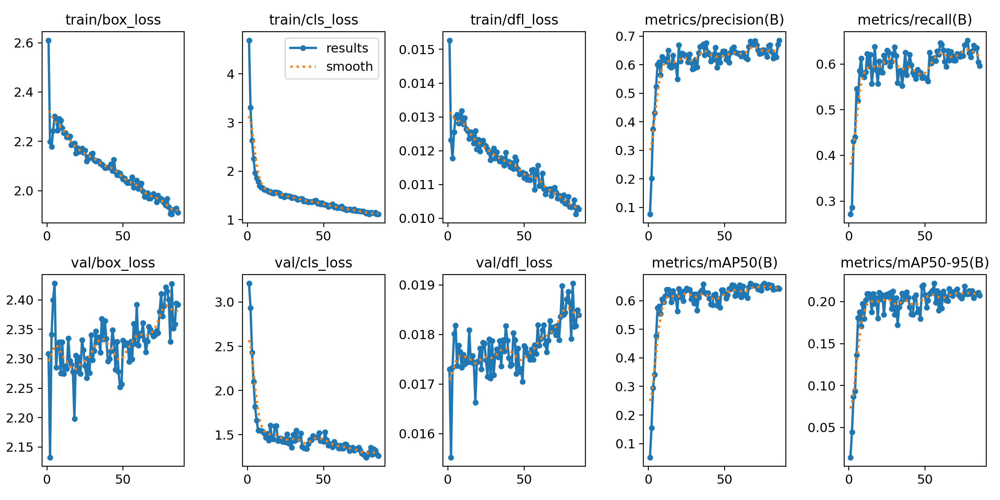
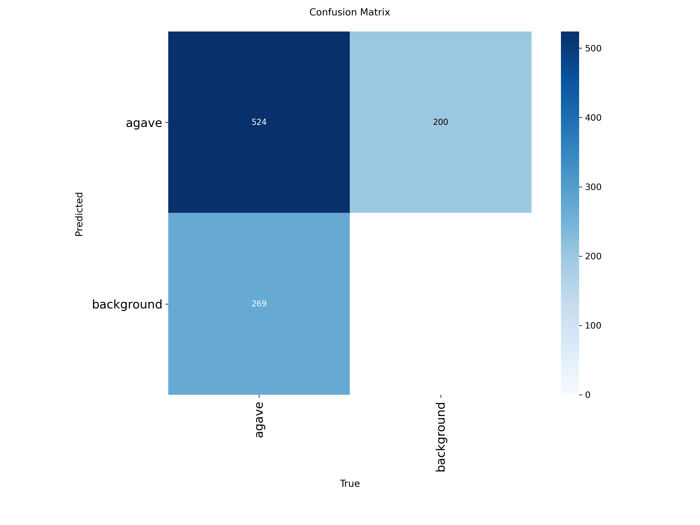
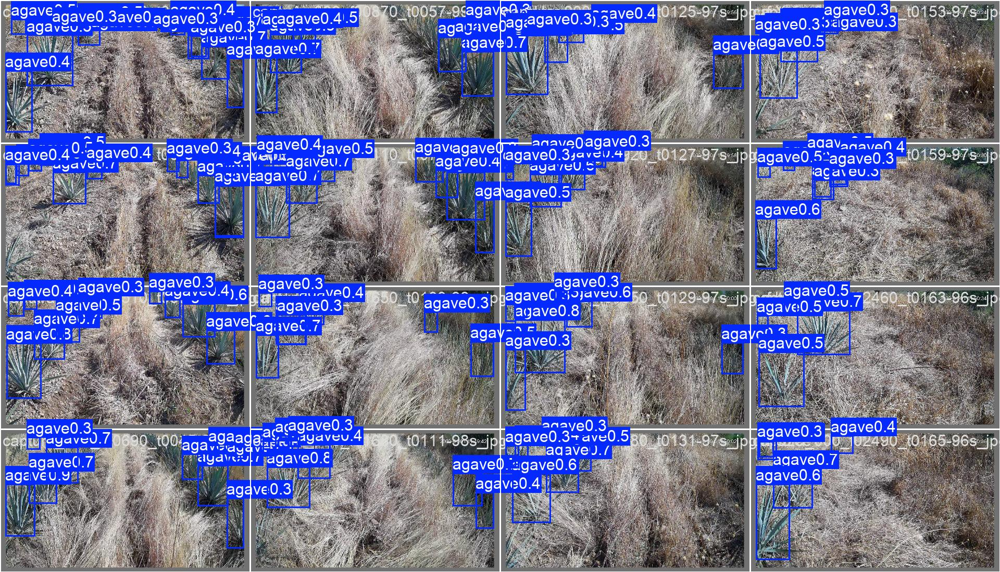
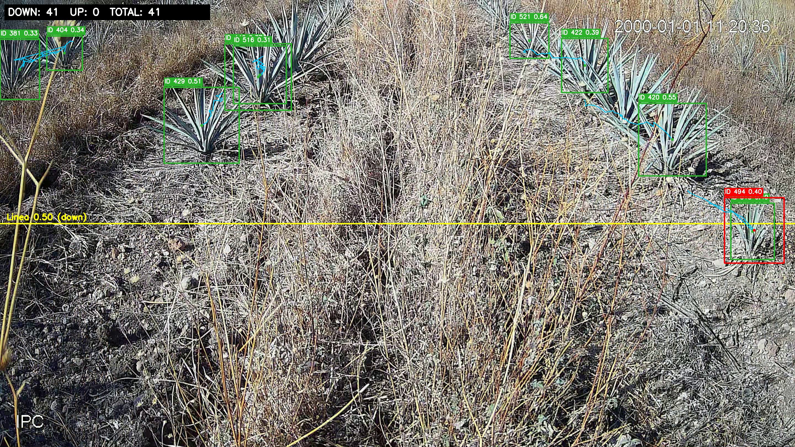

# Archivo del proyecto antes de integrar maleza

Contenido del README anterior, conservando los avances locales y actualizando las rutas reorganizadas. Todas las metricas siguientes corresponden al dataset historico de 404 imagenes, no al conjunto ampliado.

# Deteccion de Agave

Proyecto local para deteccion, inferencia, tracking y conteo de agaves con YOLO26, Roboflow, Pipenv y GPU NVIDIA.

## Estado del Proyecto

- Rama actual del commit: `main`
- Remoto configurado: `https://github.com/RaulVen/deteccion_agave.git`
- Entorno: Pipenv con Python `3.12.9`
- GPU validada: NVIDIA GeForce RTX 5050 Laptop GPU, CUDA disponible con PyTorch `2.10.0+cu128`
- Dataset YOLO: `datasets/yolo26`
- Particion del dataset: `train=295`, `val=73`, `test=36`
- Clase: `agave`

El dataset, los pesos, videos y carpetas completas de entrenamiento no se versionan por tamano. Se conservan localmente y quedan protegidos por `.gitignore`.

## Mejor Modelo Actual

El mejor modelo hasta ahora es:

```text
runs/detect/agave_experiments/yolo26s_sgd_cos_slow_120e/weights/best.pt
```

Este modelo queda documentado y preparado en la rama `main`. Si despues queremos publicar una rama separada para experimentos, una buena opcion seria `experiments/yolo26-agave`.

Metricas principales en test:

- Precision: `0.693`
- Recall: `0.615`
- mAP50: `0.654`
- mAP50-95: `0.213`
- Epocas corridas: `86`
- Mejor epoca: `56`

Parametros recomendados para inferencia/tracking:

```text
conf=0.30
iou=0.40
imgsz=640
device=0
```

## Benchmark de Experimentos

Los resultados completos estan en `benchmark/agave_benchmark.csv`.

| Rank | Run | Modelo base | Epocas | Mejor epoca | Precision test | Recall test | mAP50 test | mAP50-95 test |
|---:|---|---|---:|---:|---:|---:|---:|---:|
| 1 | `yolo26s_sgd_cos_slow_120e` | `yolo26s.pt` | 86 | 56 | 0.693 | 0.615 | 0.654 | 0.213 |
| 2 | `yolo26n_field_aug_60e` | `yolo26n.pt` | 60 | 55 | 0.637 | 0.539 | 0.596 | 0.201 |
| 3 | `yolo26s_adamw_box_focus_120e` | `yolo26s.pt` | 105 | 75 | 0.659 | 0.509 | 0.581 | 0.200 |
| 4 | `yolo26n_medium_aug_30e` | `yolo26n.pt` | 30 | 28 | 0.614 | 0.558 | 0.598 | 0.197 |
| 5 | `yolo26n_field_aug_90e` | `yolo26n.pt` | 79 | 54 | 0.631 | 0.539 | 0.599 | 0.192 |
| 6 | `yolo26s_adamw_cos_low_lr_120e` | `yolo26s.pt` | 57 | 27 | 0.633 | 0.521 | 0.589 | 0.192 |
| 7 | `yolo26s_field_aug_60e` | `yolo26s.pt` | 60 | 40 | 0.622 | 0.583 | 0.609 | 0.192 |
| 8 | `yolo26s_loss_box_dfl_45e` | `yolo26s.pt` | 45 | 40 | 0.617 | 0.529 | 0.571 | 0.186 |
| 9 | `yolo26s_coslr_balanced_45e` | `yolo26s.pt` | 44 | 32 | 0.549 | 0.603 | 0.567 | 0.183 |
| 10 | `yolo26s_loss_precision_45e` | `yolo26s.pt` | 20 | 8 | 0.596 | 0.546 | 0.526 | 0.157 |
| 11 | `agave_quick_test` | `yolo26n.pt` | 3 | 3 | 0.431 | 0.407 | 0.370 | 0.109 |

## Imagenes de Resultado

Curvas del mejor entrenamiento:



Matriz de confusion:



Predicciones de validacion:



Captura final de tracking y conteo:



## Reportes de Tesis

Se agregaron reportes Word reproducibles generados desde `scripts/` y basados en el modelo ganador `yolo26s_sgd_cos_slow_120e`:

- `docs/reportes/Reporte_avance_tesis_deteccion_agave_yolo.docx`
- `docs/reportes/Reporte_tesis_proceso_completo_agave.docx`
- `docs/reportes/Reporte_especifico_modelo_agave.docx`
- `docs/reportes/Reporte_optimizadores_lr_aumentacion_agave.docx`

Tambien se agregaron figuras explicativas en `docs/results/` sobre aumentacion de datos, arquitectura/metricas del modelo, matriz de confusion legible, accuracy operacional y tracking final.

## Paper de Congreso Local

Checklist local, sin commit ni push:

- [x] Roboflow verificado en vivo: el proyecto real es `raul-stlme/agave-vty65` (`agave`), con 404 imagenes, splits 295/73/36 y clase `agave`.
- [x] Deriva documentada: `data.yaml` conserva `raul-stlme/raul-stlme`; Roboflow vivo suma 4373/4374 anotaciones y el export local usado por el benchmark tiene 4371 cajas.
- [x] Scripts reproducibles en `src/`: `analisis_agave_tesis.py`, `analisis_extendido.py`, `figuras_en.py`.
- [x] Estadisticas completas y sanity checks en `docs/evidencia/estadisticas_agave_tesis.json`.
- [x] Figuras en espanol en `docs/evidencia/figuras/` y figuras en ingles en `docs/evidencia/figuras_en/`.
- [x] Insumos de redaccion en `docs/paper/insumos_paper.md`.
- [x] Paper extendido en ingles compilado: `docs/paper/paper_agave_detection_en.pdf`.
- [x] Bibliografia verificada en vivo en `docs/paper/referencias_verificadas.md`.
- [x] Limitaciones explicitas: dataset de una sola clase, test pequeno, conteo sin ground truth manual frame-a-frame y sin GSD/calibracion de camara.

## Tracking y Conteo

Se agrego un script para tracking con ID unico y conteo por cruce de linea horizontal:

```text
scripts/track_count_line.py
```

Configuracion de tracker:

```text
configs/tracking/botsort_agave.yaml
```

Ultima prueba sobre el segmento `01:30` a `02:00` del video `3.mp4`:

- Linea horizontal: `50%` del frame
- Direccion de conteo: hacia abajo
- Conteo corregido: `41` IDs unicos
- CSV local: `video_predictions/3_segment_01m30s_02m00s_tracking_line50_down_unique.csv`
- Video local: `video_predictions/3_segment_01m30s_02m00s_tracking_line50_down_unique.mp4`

Comando usado:

```powershell
$env:PIPENV_VENV_IN_PROJECT='1'
py -3.12 -m pipenv run python scripts/track_count_line.py `
  --model "runs/detect/agave_experiments/yolo26s_sgd_cos_slow_120e/weights/best.pt" `
  --source "video_predictions/3_segment_01m30s_02m00s.mp4" `
  --output "video_predictions/3_segment_01m30s_02m00s_tracking_line50_down_unique.mp4" `
  --csv "video_predictions/3_segment_01m30s_02m00s_tracking_line50_down_unique.csv" `
  --tracker "configs/tracking/botsort_agave.yaml" `
  --line-ratio 0.50 `
  --direction down `
  --conf 0.30 `
  --iou 0.40 `
  --imgsz 640 `
  --device 0 `
  --unique-id-only `
  --show-conf
```

## Entrenamiento

Las configuraciones probadas se encuentran en:

```text
configs/training/historico_2026-05_06/
```

La configuracion ganadora es:

```text
configs/training/historico_2026-05_06/yolo26s_sgd_cos_slow_120e.yaml
```

Resumen de esa corrida:

- Modelo base: `yolo26s.pt`
- Optimizador: `SGD`
- Learning rate inicial: `0.005`
- Cosine LR: `true`
- Epocas configuradas: `120`
- Early stopping/patience: `30`
- Batch: `8`
- Mosaic: `0.0`
- Rotacion: `0`
- Translacion: `0.0`
- Flip vertical: `0.5`
- Flip horizontal: `0.5`

## Estructura Versionada

```text
benchmark/
docs/results/
scripts/
configs/tracking/
configs/training/historico_2026-05_06/
datasets/yolo26/data.yaml
Pipfile
Pipfile.lock
README.md
.gitignore
```

## Notas de Versionamiento

No se suben a Git:

- `.venv/`
- `datasets/**/images/`
- `datasets/**/labels/`
- `runs/`
- `video_predictions/`
- pesos `*.pt`
- videos generados

Esto mantiene el repo ligero y evita subir archivos grandes al remoto por accidente.
