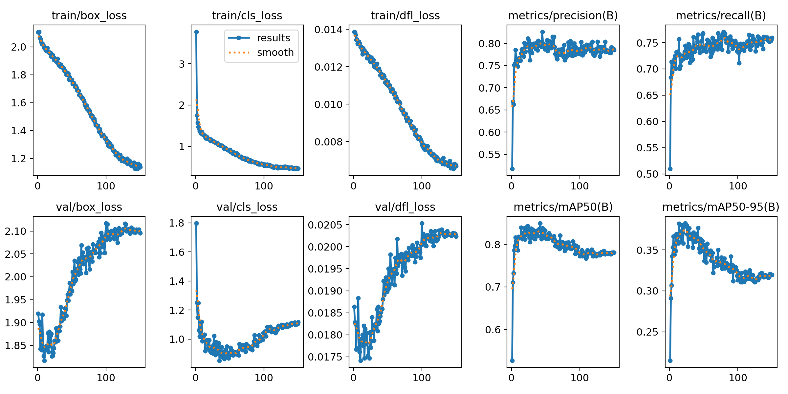
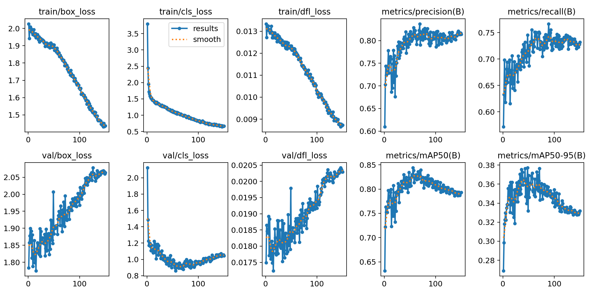

# Resultados: detección de agave con imágenes de maleza

Los dos modelos completaron exactamente las épocas 1 a 150, sin parada temprana. La campaña terminó el 22 de octubre de 2026 a las 00:51, hora de Ciudad de México. El estado final es `completed`, las evaluaciones de validación y prueba están disponibles y el registro de errores del lanzador está vacío.

Las figuras y archivos ligeros enlazados se incluyen como [copias para redacción](resultados/README.md), disponibles al clonar el repositorio. Los checkpoints, datasets y salidas completas permanecen en la computadora de cálculo.

## Comparación en el conjunto de prueba

Estas métricas corresponden a `weights/best.pt`, seleccionado por mAP50-95 de validación. Ambos modelos se evaluaron sobre las mismas 136 imágenes de prueba; la prueba no se utilizó para elegir la época. Todos los valores de métricas se expresan como porcentajes.

| Orden | Modelo | Optimizador efectivo | Épocas realizadas | Mejor época según validación | Precisión | Recall | mAP50 | mAP50-95 |
|---|---|---|---:|---:|---:|---:|---:|---:|
| 1 | YOLO26s | SGD | 150 | 23 | 68.20 | 62.52 | 66.55 | 24.32 |
| 2 | YOLO26n, aumentos de campo | AdamW, elegido por `auto` | 150 | 48 | 67.63 | 51.71 | 58.61 | 22.23 |

YOLO26s obtiene 2.10 puntos porcentuales más de mAP50-95 y 10.81 puntos más de recall. Es la opción preferida entre estas dos configuraciones para las siguientes pruebas de detección. Esta comparación incluye diferencias de arquitectura, optimizador y calendario de aprendizaje; no aísla el efecto de una sola variable. No se midió aquí la velocidad de despliegue con un protocolo específico.

## Mejor época y última época

Completar 150 épocas no significa que los pesos de la última época sean los mejores. Se conservaron tanto `best.pt` como `last.pt`.

La siguiente tabla procede exclusivamente de las curvas de validación de `results.csv`; no son resultados de prueba.

| Modelo | Mejor época | mAP50-95 de validación en esa época | mAP50-95 de validación en época 150 | Cambio en puntos porcentuales |
|---|---:|---:|---:|---:|
| YOLO26s + SGD | 23 | 38.25 | 31.96 | -6.29 |
| YOLO26n + AdamW | 48 | 37.72 | 33.20 | -4.52 |

Al reevaluar `best.pt`, el mAP50-95 de validación fue 38.33% para YOLO26s y 37.69% para YOLO26n. Esa reevaluación es distinta del registro durante entrenamiento; por eso no se sustituyen sus valores en la tabla de evolución. Las métricas de prueba de la primera tabla son de `best.pt`; no se ha hecho una evaluación de prueba adicional de `last.pt`.

Hay evidencia de sobreajuste en ambas corridas: las pérdidas de entrenamiento disminuyen mientras aumentan las pérdidas de validación y cae su mAP50-95 después del máximo. Por ejemplo, entre la mejor época y la 150, la pérdida de cajas de entrenamiento baja de 1.925 a 1.138 en YOLO26s, mientras la de validación sube de 1.833 a 2.096. En YOLO26n ocurre de 1.905 a 1.437 en entrenamiento y de 1.856 a 2.063 en validación. Las 150 épocas completas permiten documentar esta evolución en la tesis.

## Curvas completas

YOLO26s + SGD:

YOLO26n + AdamW, aumentos de campo:

## Archivos y condiciones del experimento

- [Resultados y pesos de YOLO26s](resultados/agave_maleza_150ep_2026-10-21/yolo26s_sgd_640_150e) y `runs/detect/agave_maleza_150ep_2026-10-21/yolo26s_sgd_640_150e/weights/best.pt` (solo en la computadora de cálculo).
- [Resultados y pesos de YOLO26n](resultados/agave_maleza_150ep_2026-10-21/yolo26n_campo_640_150e) y `runs/detect/agave_maleza_150ep_2026-10-21/yolo26n_campo_640_150e/weights/best.pt` (solo en la computadora de cálculo).
- [Benchmark con valores completos](../benchmark/agave_maleza_150ep_2026-10-21/agave_benchmark.csv) y [estado y verificación de integridad](../benchmark/agave_maleza_150ep_2026-10-21/status.json).
- Cada carpeta de resultados contiene `results.csv`, `results.png`, `weights/best.pt`, `weights/last.pt` y las evaluaciones `evaluation/val` y `evaluation/test`, con curvas precisión-recall y matrices de confusión.
- Resolución: 640 px; batch efectivo: 8; semilla: 26; `epochs=150`, `patience=0`, `time=null`, `flipud=0`. Se conservaron los aumentos de iluminación: `hsv_h=0.02`, `hsv_s=0.55`, `hsv_v=0.35`.
- Dataset combinado: 1493 imágenes de entrenamiento, 435 de validación y 136 de prueba. Las 166 imágenes reservadas quedaron fuera.

## Alcance de la conclusión

El rendimiento en prueba es inferior al de validación: todavía hay margen para mejorar la generalización. La evaluación es interna al conjunto disponible y no demuestra por sí sola rendimiento en otra parcela o fecha de captura. Se conserva la limitación de que algunas imágenes provienen de una misma salida de campo y las observaciones de etiquetas ya documentadas.

Los resultados no deben presentarse como una mejora directa frente al benchmark histórico porque cambió el conjunto de datos. Para esa comparación sería necesario evaluar los pesos anteriores y nuevos sobre un conjunto de prueba común y sin contaminación con su entrenamiento.
