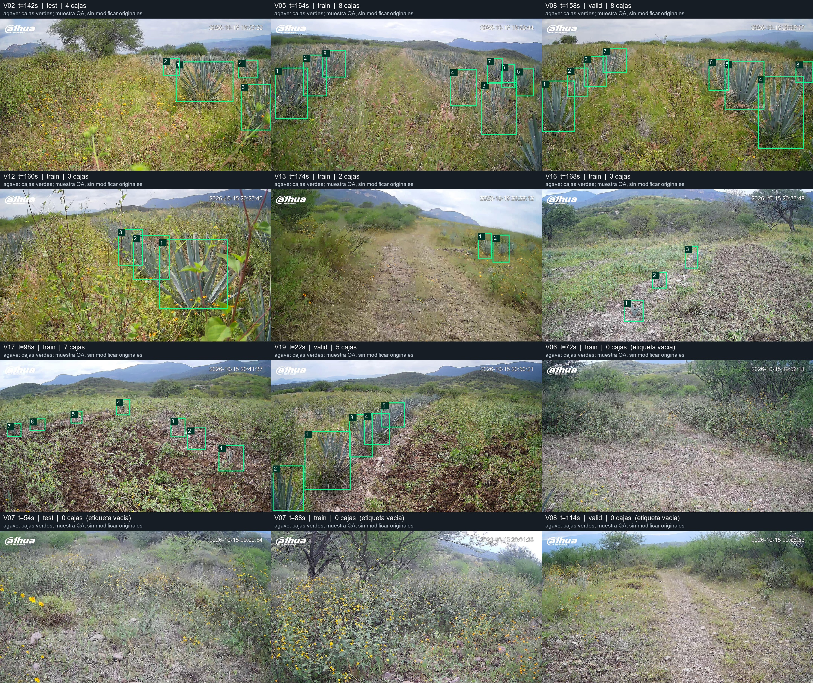

# Revision visual acotada de las etiquetas

Se revisaron 12 imagenes de la exportacion: ocho positivas de videos diferentes y cuatro con etiqueta vacia. Las cajas se ven alineadas con las imagenes, sin desplazamiento ni error de escala. Esto no constituye una revision manual completa de las 1826 imagenes.

Los nombres train/valid/test impresos en la hoja corresponden al ZIP original de Roboflow. La particion final es la del manifiesto del dataset combinado.

## Casos que conviene revisar antes de entrenar

1. [Video 12, segundo 160](ejemplos/maleza__v12_f02400.jpg): aparecen agaves en el lado izquierdo sin cajas. Revisar la exhaustividad del etiquetado y aplicar un criterio uniforme a plantas parcialmente ocultas.
2. [Video 06, segundo 72](ejemplos/maleza__v06_f01080.jpg): etiqueta vacia, con una hoja parcial en la esquina inferior izquierda. Confirmar el criterio para objetos extremadamente parciales; puede ser un negativo correcto si se excluyen esos fragmentos.

Los dos enlaces muestran copias de las imágenes originales de `datasets/prepared/agave_maleza_2026-10-21/images/train/`, incluidas como ejemplos documentales para consulta desde la computadora de redacción. El dataset completo permanece local.

Se conservaron las etiquetas exportadas y ambos ejemplos siguen en train. No se inventaron anotaciones ni se altero automaticamente el criterio manual. El JSON de auditoria contiene sus nombres originales de Roboflow. Si se corrigen etiquetas, cerrar las correcciones antes de iniciar la serie y actualizar los hashes del manifiesto para mantener la trazabilidad.
