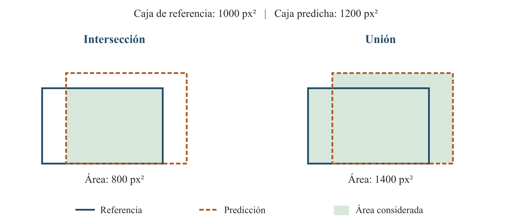

# Capítulo 2. Marco teórico

Para que un equipo de deshierbe pueda evitar el contacto con los agaves, primero necesita conocer dónde se encuentran. En este trabajo, esa información se obtiene a partir de imágenes RGB y de un modelo de detección de objetos. La cámara registra la escena y la red neuronal analiza cada imagen para localizar las plantas.

En este capítulo se explica cómo se realiza ese proceso. Se presentan los fundamentos de las redes neuronales y la estructura general de YOLO, así como la preparación de los datos y las transformaciones utilizadas durante el entrenamiento. Después se describen las métricas con las que se evalúa el detector, el seguimiento de las plantas en video y los aspectos necesarios para utilizar esta información en un sistema de deshierbe.

## 2.1 Deshierbe selectivo y protección del cultivo

El deshierbe selectivo busca retirar la vegetación no deseada y conservar las plantas del cultivo. Cuando esta tarea se realiza con un mecanismo guiado por visión, es necesario relacionar la posición de las plantas con el área sobre la que puede actuar la herramienta. Xiang et al. describen dos estrategias: detectar la maleza para intervenir sobre ella, o detectar el cultivo para que el mecanismo lo evite [1].

En esta investigación se sigue la segunda estrategia. El sistema identifica los agaves y obtiene su ubicación dentro de la imagen. A partir de esta información se plantea establecer una región alrededor de cada planta en la que se inhiba la acción del mecanismo. La maleza continúa siendo el objetivo del deshierbe, aunque el modelo se entrena para reconocer únicamente el agave.

Esta distinción define también cómo deben interpretarse los errores del detector. Si un agave no aparece entre las detecciones, puede deberse a que está oculto, se observa con poco detalle o fue confundido con el fondo. Por lo tanto, una región sin detecciones no puede considerarse automáticamente libre de agaves. La protección del cultivo requiere tomar en cuenta estas omisiones junto con la posición y el movimiento de la herramienta.

## 2.2 Imágenes RGB y condiciones de campo

Una imagen digital está formada por píxeles. En una imagen RGB, cada píxel contiene tres valores asociados a los canales rojo, verde y azul. La combinación de estos valores permite representar los colores de la escena. Los cambios entre píxeles también proporcionan información sobre los bordes, las formas y las texturas de los objetos.

En campo, la apariencia de una planta cambia con la iluminación, las sombras, la distancia y el ángulo de la cámara. La vegetación que la rodea puede dificultar su reconocimiento, sobre todo cuando presenta colores o formas similares. Qu y Su señalan estas variaciones como parte de los problemas del reconocimiento visual de cultivos y malezas [2].

En el caso del agave, interesa reconocer la planta aun cuando parte de sus hojas se encuentre cubierta por maleza. Esta situación se conoce como oclusión: un objeto impide observar una parte de otro. También puede ocurrir que un agave lejano ocupe pocos píxeles y pierda detalles que sí son visibles en una planta cercana.

La maleza seca y la maleza húmeda se consideran condiciones del entorno. Para estudiar su efecto es necesario definir cómo se identifica cada condición y conservar ese registro en los datos. El color verde, por sí solo, no es una medición de humedad. De igual manera, modificar digitalmente el color de una imagen no equivale a capturar una parcela bajo otra condición real. Esta diferencia es importante al preparar y evaluar el conjunto de imágenes.

## 2.3 Redes neuronales convolucionales

Una red neuronal es un modelo formado por operaciones conectadas entre sí. Sus parámetros, entre ellos los pesos de las conexiones, se ajustan durante el entrenamiento para relacionar una entrada con una respuesta esperada. En este proyecto, la entrada es una imagen y la respuesta esperada incluye la ubicación de los agaves que aparecen en ella.

Las redes neuronales convolucionales, conocidas como CNN por *Convolutional Neural Networks*, utilizan filtros que recorren regiones de la imagen. Cada filtro combina los valores de una región y produce una respuesta. Al aplicar el mismo filtro en diferentes posiciones se forma un mapa de características. Una capa es una etapa de operaciones que recibe datos y entrega una nueva representación. Las funciones de activación introducen relaciones no lineales, y las capas sucesivas combinan los mapas para representar patrones más elaborados [3].

Por ejemplo, algunos patrones útiles para reconocer un agave pueden relacionarse con los bordes alargados de sus hojas y con su distribución alrededor del centro de la planta. Estos ejemplos ayudan a entender la tarea, pero no significan que cada filtro tenga asignada una función como “detectar una hoja”. Los valores de los filtros se aprenden a partir de las imágenes y sus anotaciones.

El entrenamiento utilizado es supervisado. Esto significa que las imágenes se acompañan de anotaciones que indican qué debe reconocer el modelo. En detección, una anotación incluye la clase del objeto y una caja que lo delimita. Si una planta visible queda sin anotar, el ejemplo puede enseñar una relación incorrecta entre la imagen y la respuesta esperada. Por ello, la revisión de las etiquetas forma parte del desarrollo del modelo.

El aprendizaje por transferencia permite comenzar con pesos obtenidos previamente en otro conjunto de datos. Después, esos pesos se ajustan a la tarea del agave. Yosinski et al. estudiaron la transferencia de características entre tareas y mostraron que su utilidad depende, entre otros factores, del nivel de la red y de la relación entre los datos de origen y destino [4]. En este trabajo se utiliza este procedimiento para aprovechar un modelo preentrenado y adaptarlo a las imágenes de campo.

## 2.4 Detección de objetos y cajas delimitadoras

La clasificación, la detección y la segmentación resuelven tareas relacionadas, pero sus salidas son diferentes. Un clasificador puede indicar si una imagen contiene un agave. Un detector, además, estima dónde se encuentra cada planta mediante una caja. La segmentación describe las regiones de la imagen a nivel de píxel, por lo que puede representar un contorno más detallado. El desarrollo actual utiliza detección de objetos [5].

Una caja puede expresarse con las coordenadas de sus esquinas: (x₁, y₁) y (x₂, y₂). Los valores x indican la posición horizontal y los valores y, la vertical. A la caja se le asignan una clase y una puntuación de confianza. En este caso, la única clase entrenada es agave; la maleza y el suelo forman parte del entorno visual.

Para obtener el centro de la caja se promedian las coordenadas de sus extremos:

x_c = (x₁ + x₂) / 2;     y_c = (y₁ + y₂) / 2                                      (2.1)

Este centro resulta útil para seguir el desplazamiento de la detección y registrar cruces de una línea. Sin embargo, sigue siendo una posición en la imagen: no representa directamente la distancia en centímetros entre el agave y la herramienta. Además, una caja puede contener suelo o maleza entre las hojas. Su utilidad consiste en proporcionar una localización aproximada de la planta, que después debe relacionarse con la geometría del equipo.

## 2.5 Estructura general de YOLO

YOLO proviene de la expresión *You Only Look Once*. La propuesta original reunió la predicción de cajas y categorías dentro de una misma red, de modo que la imagen completa se procesa para producir las detecciones [5]. Las versiones posteriores han cambiado la estructura y el entrenamiento. En los siguientes apartados se describe el funcionamiento general de YOLO26, que es la familia utilizada en este trabajo.

### 2.5.1 Preparación de la imagen de entrada

Antes de entrar a la red, la imagen se ajusta al tamaño de procesamiento. En Ultralytics puede utilizarse el procedimiento llamado *letterbox*, que conserva la proporción entre ancho y alto y completa el espacio necesario con bordes [6].

Como ejemplo, una imagen de 2880 × 1620 píxeles puede reducirse a 640 × 360. Si se requiere una entrada cuadrada de 640 × 640, el espacio vertical restante se completa con relleno. Así se evita estirar el agave para hacerlo caber en un cuadrado. La forma final depende de la configuración: cuando se emplea relleno rectangular mínimo, indicar un tamaño de 640 no implica necesariamente una entrada de 640 × 640.

Los canales de color se organizan en el formato esperado por la red. En el procesamiento habitual, los valores de intensidad de 0 a 255 se dividen entre 255 para expresarlos entre cero y uno; esto se denomina normalización. Estas operaciones constituyen el preprocesamiento [6]. Reducir la imagen disminuye la cantidad de información que debe procesarse, aunque también puede eliminar detalles de las plantas pequeñas. Por ello, el tamaño de entrada influye tanto en la detección como en el tiempo de cálculo.

### 2.5.2 Extracción, combinación y predicción

Para explicar el recorrido de la imagen se pueden distinguir tres funciones: extraer características, combinar información de distintas escalas y producir las detecciones. Habitualmente se denominan *backbone*, *neck* y *head*. A continuación se explica la función de cada una [7].

El **backbone**, o extractor de características, transforma la imagen en mapas calculados por las capas de la red. En las primeras etapas se conserva mayor detalle espacial. Al avanzar, las representaciones combinan información de regiones más amplias. En lugar de comparar la imagen con una fotografía fija de un agave, la red utiliza los patrones que aprendió durante el entrenamiento [3].

El **neck**, o bloque de combinación, reúne mapas obtenidos en distintas etapas. Esta combinación permite utilizar tanto información de detalle como características procedentes de capas más profundas. En YOLO26, la cabeza recibe mapas con reducciones espaciales de 8, 16 y 32 respecto a la entrada [7].

Para una entrada cuadrada de 640 × 640, esas reducciones corresponden a mapas de 80 × 80, 40 × 40 y 20 × 20 posiciones. No son tres fotografías reducidas: cada posición contiene varios valores calculados por la red. En una escena de cultivo, esta organización aporta información para reconocer tanto plantas cercanas y grandes como plantas lejanas que ocupan una región pequeña.

La **head**, o cabeza de detección, utiliza los mapas combinados para calcular las cajas y las puntuaciones de clase. En el modelo del proyecto se predice la clase agave. Finalmente, las coordenadas se relacionan con el tamaño de la imagen original para mostrar las cajas y utilizar su posición [7, 6]. La figura 2.1 resume este recorrido.

![Figura 2.1. Flujo simplificado de un detector YOLO. Se muestran sus funciones principales, no todas las capas. Elaboración propia a partir de [7] y [6].](figuras_capitulo2/estructura_yolo.png)

### 2.5.3 Variantes del modelo y selección de detecciones

YOLO26n y YOLO26s son variantes de diferente capacidad. Las letras n y s corresponden a nano y small. La profundidad se relaciona con la repetición de bloques de la red y la anchura, con el número de mapas o canales internos que se calculan. Estos canales contienen respuestas de la red y se distinguen de los tres canales RGB de la entrada. En la configuración utilizada ambas variantes comparten el factor de profundidad y difieren en el de anchura. La variante small requiere más operaciones, aunque una mayor capacidad no asegura por sí sola mejores resultados para cualquier conjunto de imágenes [7].

La ejecución del modelo sobre una imagen nueva se denomina inferencia. La confianza sirve para decidir qué predicciones se conservan. Cuando el procedimiento utiliza supresión de no máximos, o NMS, también se filtran cajas redundantes según su solapamiento y puntuación. YOLO26 dispone de una ruta de inferencia de extremo a extremo que puede producir detecciones sin esa etapa separada [7]. Las variantes n y s, el tamaño de entrada y el formato de ejecución influyen en el comportamiento del sistema, por lo que se comparan considerando las detecciones y el tiempo de procesamiento.

## 2.6 Entrenamiento y organización de los datos

### 2.6.1 Entrenamiento, validación y prueba

Las imágenes se separan según la función que cumplen. El conjunto de **entrenamiento** se utiliza para ajustar los pesos. El de **validación** permite observar el comportamiento durante el desarrollo y seleccionar una configuración o un conjunto de pesos. El de **prueba** se utiliza para evaluar la configuración fijada sobre datos que no se emplearon para ajustar los pesos [8, 9].

En imágenes obtenidas de video, la separación debe considerar su origen. Dos fotogramas consecutivos pueden mostrar prácticamente la misma planta, el mismo fondo y la misma iluminación. Si se reparten entre entrenamiento y prueba, el resultado puede reflejar el reconocimiento de escenas muy similares a las ya utilizadas. La fuga de información es uno de los problemas que puede producir estimaciones demasiado optimistas del desempeño [9].

Para este proyecto resulta conveniente conservar la identificación del video, recorrido y sesión de captura. Estos datos permiten analizar qué tan independientes son los conjuntos. Las imágenes transformadas mediante aumento de datos deben permanecer en la misma partición que su imagen de origen.

### 2.6.2 Épocas, lotes y optimización

Durante el entrenamiento se procesan grupos de imágenes llamados lotes o *batches*. Después de cada actualización se modifican los pesos de acuerdo con la función de pérdida. Una época corresponde a un recorrido del conjunto de entrenamiento. Así, entrenar 150 épocas significa realizar 150 recorridos, no utilizar 150 imágenes.

La función de pérdida expresa diferencias entre las predicciones y las anotaciones. El optimizador utiliza esas diferencias para ajustar los pesos. El gradiente indica cómo cambia la pérdida al modificar los parámetros. El descenso de gradiente estocástico (SGD) realiza sus actualizaciones a partir del gradiente calculado sobre los datos del lote; la tasa de aprendizaje controla el tamaño del cambio [8]. AdamW utiliza ajustes adaptativos y separa de esa actualización el decaimiento de pesos, que reduce su magnitud durante el ajuste [10].

La tasa de aprendizaje puede cambiar a lo largo del entrenamiento. Un calendario cosenoidal la modifica de manera gradual siguiendo una función coseno. Aunque existen métodos que combinan este calendario con reinicios [11], usar un calendario cosenoidal no significa que se hayan aplicado reinicios en los experimentos propios.

### 2.6.3 Generalización y selección de los pesos

El propósito del entrenamiento es que el modelo funcione en imágenes nuevas. Esta capacidad se denomina generalización. Si el modelo se ajusta cada vez mejor a las imágenes de entrenamiento, pero empeora en validación, puede estar ocurriendo sobreajuste [8].

Los pesos guardados durante el proceso se conocen como puntos de control o *checkpoints*. El archivo del mejor resultado de validación puede corresponder a una época anterior a la última. Por ello, es necesario distinguir el número total de épocas realizadas de la época cuyos pesos se utilizan para evaluar o ejecutar el detector. Las curvas de pérdida y las métricas de validación permiten interpretar esa selección.

## 2.7 Aumento de datos

El aumento de datos, o *data augmentation*, consiste en generar variaciones de las imágenes de entrenamiento mediante transformaciones. Se puede cambiar su apariencia, modificar su geometría o combinar información de varias imágenes. La finalidad es presentar ejemplos distintos sin tener que capturar una fotografía nueva para cada variación [12].

Por ejemplo, una imagen de un agave puede verse ligeramente más oscura en una actualización y tener otro tamaño en una actualización posterior. De esta manera se busca reducir la dependencia del modelo respecto a detalles particulares de la captura. La transformación debe conservar una relación válida entre la imagen y sus anotaciones.

### 2.7.1 Diferencia entre preprocesamiento y aumento de datos

El preprocesamiento adapta la imagen al formato de entrada: tamaño, canales y escala de los valores. El aumento introduce variaciones, generalmente aleatorias, para el aprendizaje. Ambas operaciones pueden aparecer en el mismo flujo, pero cumplen funciones distintas [13].

Los aumentos pueden generarse durante el entrenamiento sin guardar cada variante en una carpeta. Por ello, su uso no significa necesariamente que aumente el número de archivos del conjunto original. Una imagen puede producir variaciones diferentes en distintas épocas y seguir contándose como una sola captura. Estas variaciones tampoco equivalen a observaciones independientes de otras parcelas.

### 2.7.2 Cambios de color e iluminación

Los ajustes de color pueden realizarse en el espacio HSV. La componente H corresponde al tono; S, a la saturación o intensidad del color; y V, al valor relacionado con su brillo. Modificar estas componentes permite variar la apariencia sin cambiar directamente la posición de las cajas [13].

En una escena con agaves, una variación moderada de brillo puede representar una imagen más clara u oscura. Cambiar la saturación puede producir colores menos intensos. La variación del tono modifica la tonalidad, por lo que debe mantenerse en un rango que conserve una apariencia razonable para el problema.

Los parámetros de estas transformaciones expresan amplitudes, no porcentajes de imágenes. Por ejemplo, un valor de 0.35 para el ajuste de brillo no significa que se modifique exactamente el 35 % del conjunto. Tampoco demuestra que se hayan reproducido todas las sombras o condiciones de iluminación presentes en campo. Se trata de variaciones digitales cuya utilidad debe evaluarse con imágenes reales.

### 2.7.3 Transformaciones geométricas y etiquetas

Las transformaciones geométricas modifican la posición, el tamaño o la forma proyectada de los objetos. Si la imagen cambia, sus cajas deben cambiar con ella. Dejar una caja en su posición anterior después de mover la planta produciría una anotación incorrecta [14].

| Transformación | Cambio en la imagen | Relación con el problema del agave |
|---|---|---|
| Escala | Agranda o reduce los elementos. | Introduce variación en el tamaño aparente de las plantas. |
| Reflexión horizontal | Invierte izquierda y derecha. | Cambia la distribución lateral de la escena. |
| Cizallamiento | Inclina la geometría de la imagen. | Introduce deformaciones de la proyección, distintas de una rotación. |
| Perspectiva | Modifica la proyección de la escena. | Produce variaciones geométricas que deben mantenerse moderadas. |

El parámetro de escala determina un intervalo de factores. Con una amplitud de 0.35 se pueden muestrear factores entre 0.65 y 1.35 antes de las demás operaciones de ajuste. En cambio, una probabilidad de reflexión horizontal de 0.5 indica que la operación puede aplicarse aproximadamente en la mitad de las ocasiones; no asegura que se refleje exactamente la mitad de los archivos [14].

El cizallamiento y la perspectiva necesitan especial cuidado. Pueden ampliar las variaciones de la imagen, pero una deformación excesiva también puede producir plantas poco representativas de la captura prevista. Si una transformación recorta parte de un agave o desplaza una caja fuera de la imagen, la anotación debe ajustarse o descartarse según los criterios del proceso de preparación.

### 2.7.4 Combinación de imágenes

MixUp combina imágenes mediante una suma ponderada. Su formulación original utiliza combinaciones de ejemplos y etiquetas para el aprendizaje [15]. En la implementación de detección utilizada, las intensidades de dos imágenes se mezclan y se conservan las anotaciones correspondientes a ambas [14]. El resultado puede parecer una superposición: no es una fotografía natural, sino un ejemplo de entrenamiento.

Una probabilidad MixUp de 0.05 significa que la mezcla se intenta aproximadamente en el 5 % de las ocasiones en que esa transformación está habilitada. No significa añadir de manera fija un 5 % de archivos al conjunto. Además, su activación puede cambiar al final del entrenamiento según el calendario configurado.

Mosaic es otra técnica de combinación, difundida en YOLOv4, que reúne regiones de varias imágenes en una composición [16]. Conviene distinguirla de MixUp: la primera organiza imágenes en un mosaico y la segunda mezcla sus intensidades. La disponibilidad de una técnica en el programa no demuestra que se haya utilizado en un entrenamiento determinado.

### 2.7.5 Interpretación de los aumentos utilizados

En las cuatro configuraciones nuevas de octubre se habilitaron variaciones de color, escala, reflexión horizontal, cizallamiento, perspectiva y MixUp. Rotación y traslación aleatorias, reflexión vertical y Mosaic quedaron desactivadas. Tampoco se programó un cierre anticipado de MixUp: la opción correspondiente se mantuvo en cero. Los valores completos se presentan en metodología, junto con la versión del programa utilizada.

También es necesario distinguir las opciones propias de detección de las que solo actúan en clasificación. Un archivo general de configuración puede guardar parámetros como borrado aleatorio o *auto augment* sin que intervengan en el entrenamiento del detector. La interpretación debe basarse en las transformaciones efectivamente ejecutadas [14].

El aumento se aplica al conjunto de entrenamiento. Para comparar modelos se mantienen condiciones definidas de validación y prueba, sin introducir las transformaciones aleatorias del aprendizaje. Existe también aumento durante la inferencia, conocido como TTA por *test-time augmentation*, pero es un procedimiento distinto y debe declararse cuando se utiliza [13]. Por último, los cambios digitales no sustituyen las capturas de maleza seca y húmeda, oclusiones y otros escenarios que se pretende estudiar.

## 2.8 Métricas para evaluar la detección

Observar las cajas sobre una imagen ayuda a revisar el funcionamiento del modelo, pero no permite comparar de manera completa dos configuraciones. Para ello se necesitan criterios que indiquen cuántas plantas se reconocieron, cuántas predicciones fueron incorrectas y qué tan bien se localizaron los objetos.

La evaluación utiliza las anotaciones como referencia, también llamadas *ground truth*. Estas representan la respuesta esperada bajo el criterio de etiquetado. Los errores de anotación afectan la evaluación: una planta visible que no fue etiquetada podría hacer que una detección válida se contabilice como falsa.

### 2.8.1 Confianza y umbral de aceptación

La confianza es la puntuación que acompaña a una predicción. Un umbral de 0.30 conserva las detecciones cuya puntuación alcanza el criterio establecido y descarta las inferiores. Por ejemplo, una caja con puntuación 0.72 se conserva con ese umbral, mientras otra con 0.18 se descarta.

La puntuación no debe interpretarse directamente como una probabilidad comprobada de acierto. Una predicción con confianza 0.80 no demuestra, por sí sola, que el sistema acierte el 80 % de las veces en casos semejantes. Esa correspondencia requiere estudiar la calibración del modelo. Guo et al. distinguen precisamente entre las puntuaciones de una red y su correspondencia con la frecuencia real de aciertos [17].

Al aumentar el umbral se conservan menos predicciones. Pueden eliminarse falsas detecciones, pero también agaves correctos que recibieron puntuaciones menores. Al reducirlo se admiten más cajas y pueden recuperarse plantas antes omitidas, junto con nuevas falsas detecciones. Por eso el umbral influye en las métricas y debe registrarse.

### 2.8.2 Intersección sobre unión: IoU

Para decidir si una caja coincide con una planta anotada se compara su ubicación. La intersección sobre unión, o IoU, divide el área compartida por las dos cajas entre el área total que ocupan, contando una sola vez la zona común. Se utiliza como medida de coincidencia geométrica en evaluación de detección [18, 19].

IoU = área de intersección / área de unión                                         (2.2)

Si A_p es el área de la caja predicha, A_r la de referencia y A_i la intersección, entonces:

IoU = A_i / (A_p + A_r - A_i)                                                        (2.3)

El resultado se encuentra entre cero y uno. Si las cajas no se tocan, la intersección es cero. Si coinciden completamente, la intersección y la unión tienen la misma área y la IoU es uno.

Como ejemplo ilustrativo, supóngase una caja predicha de 1200 píxeles cuadrados, una de referencia de 1000 y una intersección de 800. La unión es 1200 + 1000 - 800 = 1400. Por tanto, IoU = 800/1400 = 0.5714. Esta caja cumple un criterio de IoU de al menos 0.50, pero no uno de 0.75. El ejemplo no corresponde a una medición del proyecto.

La confianza y la IoU responden a aspectos distintos. La confianza es una puntuación producida por el modelo. La IoU de evaluación se calcula comparando una caja predicha con una anotación. Una caja puede recibir confianza alta y estar mal localizada, o tener confianza baja y coincidir bien con la referencia.

### 2.8.3 Aciertos, falsas detecciones y omisiones

Una vez fijados los criterios de clase, confianza y coincidencia geométrica, se establece una correspondencia entre detecciones y anotaciones. Para el caso de una clase se utilizan tres conteos [20, 19]:

| Conteo | Significado | Ejemplo en la parcela |
|---|---|---|
| Verdadero positivo, TP | Una detección se asocia correctamente con un objeto anotado. | Una caja identifica y localiza un agave conforme al criterio de IoU. |
| Falso positivo, FP | Una detección no tiene una correspondencia válida. | Se marca maleza como agave o aparece una caja adicional sin asociación válida. |
| Falso negativo, FN | Un objeto anotado queda sin detección asociada. | Un agave visible y etiquetado no es reconocido. |

La correspondencia no permite contar varias cajas como aciertos independientes sobre el mismo agave. Si se conservan detecciones duplicadas, las que no logran una asociación válida se contabilizan como falsos positivos. Asimismo, una caja demasiado desplazada puede generar un falso positivo y dejar la anotación correspondiente como falso negativo.

Para explicar las métricas siguientes se utilizará un ejemplo hipotético: existen 20 agaves anotados y el detector produce 18 cajas. De ellas, 15 se asocian correctamente, tres son falsas detecciones y cinco agaves quedan sin reconocer. Por tanto, TP = 15, FP = 3 y FN = 5. Estas cifras se presentan únicamente con fines explicativos.

### 2.8.4 Precisión y sensibilidad o recall

La **precisión** expresa qué proporción de las detecciones conservadas fue correcta. Se calcula dividiendo los verdaderos positivos entre todas las predicciones que se contabilizan como detecciones positivas [20]:

P = TP / (TP + FP)                                                                        (2.4)

En el ejemplo, P = 15/(15 + 3) = 0.8333, es decir, 83.33 %. Esto significa que 15 de las 18 detecciones fueron correctas. La cifra no indica que se haya reconocido el 83.33 % de todos los agaves presentes, porque su denominador es el número de predicciones.

La **sensibilidad**, también llamada exhaustividad o *recall*, expresa qué proporción de los objetos anotados fue reconocida. Su denominador incluye los aciertos y las plantas omitidas [20]:

R = TP / (TP + FN)                                                                        (2.5)

En el mismo ejemplo, R = 15/(15 + 5) = 0.75, equivalente a 75 %. Se localizaron 15 de los 20 agaves anotados y se omitieron cinco. Así, precisión y recall describen errores diferentes: la primera disminuye al aumentar las falsas detecciones y el segundo disminuye al aumentar las omisiones.

Ambas son relevantes para este proyecto. Un falso positivo podría generar una región de protección innecesaria y dejar vegetación sin intervenir. Un falso negativo implica que un agave no aportó una detección para definir su protección. La decisión operativa debe considerar ambos errores, aunque el recall no representa por sí mismo una tasa de plantas protegidas físicamente.

### 2.8.5 Puntuación F1

La puntuación F1 combina precisión y recall mediante su media armónica [20]:

F1 = 2PR / (P + R)                                                                         (2.6)

También puede calcularse directamente a partir de los conteos:

F1 = 2TP / (2TP + FP + FN)                                                             (2.7)

Para el ejemplo, F1 = 30/(30 + 3 + 5) = 30/38 = 0.7895, o 78.95 %. Este valor resume el equilibrio entre precisión y recall. Si una de las dos disminuye mucho, la puntuación F1 también se reduce. Por ejemplo, un modelo que solo reconoce unas pocas plantas con gran precisión puede tener un recall bajo y, en consecuencia, un F1 limitado.

La utilidad de F1 consiste en facilitar la comparación en un punto de operación, pero asigna un tratamiento simétrico a precisión y recall. La importancia específica de omitir un agave durante el deshierbe debe analizarse por separado.

### 2.8.6 Curva precisión-recall y precisión media, AP

Las métricas anteriores se calculan para un criterio de aceptación. Sin embargo, el comportamiento cambia cuando se modifica el umbral de confianza. Para analizarlo se ordenan las predicciones por su puntuación y se obtienen pares de precisión y recall a medida que se admiten más detecciones. Con esos pares se construye la curva precisión-recall [19].

El eje horizontal representa el recall y el vertical, la precisión. Una curva que mantiene una precisión alta mientras alcanza un recall alto indica que el detector recupera gran parte de los objetos con relativamente pocas falsas detecciones. Admitir más predicciones no garantiza que ambas métricas mejoren: algunas cajas adicionales pueden ser correctas y otras, falsas.

La **precisión media**, AP por *Average Precision*, resume la curva mediante el área bajo una versión interpolada de ella. Por eso AP no es la precisión obtenida en un único umbral, ni la media de precisión y recall. El procedimiento de interpolación forma parte de la definición del evaluador [18, 20].

Como ejemplo conceptual, dos detectores pueden tener precisión de 80 % en un umbral elegido, pero mantener comportamientos diferentes al aceptar más cajas. Uno podría recuperar muchas plantas adicionales antes de introducir numerosos errores; el otro podría agregar principalmente falsas detecciones. La AP permite considerar esa diferencia a lo largo de la curva.

### 2.8.7 mAP50 y mAP50-95

La **mAP**, o media de las precisiones medias, promedia la AP de las clases evaluadas. Con K clases se expresa como:

mAP = (AP₁ + AP₂ + ... + AP_K) / K                                                  (2.8)

En esta investigación K = 1, porque solo se detecta agave. Por lo tanto, para un mismo criterio de IoU, el promedio entre clases coincide con la AP del agave. Esto no introduce una AP adicional para la maleza ni para el fondo.

La notación **mAP50** indica que la correspondencia se evalúa con un umbral de coincidencia IoU de al menos 0.50. En cambio, **mAP50-95** considera diez umbrales de IoU: 0.50, 0.55, 0.60, 0.65, 0.70, 0.75, 0.80, 0.85, 0.90 y 0.95. Se calcula la AP para cada criterio y se obtiene el promedio correspondiente [18].

Al aumentar el umbral de IoU se exige una coincidencia más precisa entre las cajas. Por ello, un detector puede alcanzar una mAP50 relativamente alta y una mAP50-95 menor. Esto es compatible con localizar plantas de forma aproximada y tener más dificultades cuando se exige un ajuste estricto de la caja.

Un ejemplo hipotético permite ver el cálculo. Si las AP para esos diez umbrales fueran 0.80, 0.77, 0.72, 0.66, 0.59, 0.49, 0.36, 0.24, 0.12 y 0.05, la mAP50 sería 0.80. La suma es 4.80 y su promedio es 0.48; por tanto, la mAP50-95 sería 48 %. Ese 48 % no significa que se haya detectado exactamente el 48 % de las plantas. Resume curvas precisión-recall bajo varios requisitos de localización.

### 2.8.8 Matriz de confusión y lectura de resultados

La matriz de confusión organiza los aciertos y errores según la clase predicha y la de referencia. En detección también se representa el fondo para registrar objetos omitidos y predicciones sin correspondencia. En el ejemplo de 20 agaves puede escribirse así:

| Predicción / referencia | Agave anotado | Sin objeto asociado |
|---|---:|---:|
| Agave detectado | 15 TP | 3 FP |
| Sin detección asociada | 5 FN | No definido |

La casilla inferior derecha no representa un número de verdaderos negativos. El fondo de una imagen puede dividirse en una cantidad arbitraria de regiones y no existe un conteo natural de todos los “no objetos”. Por esta razón, una exactitud global basada en verdaderos negativos no suele ser una medida adecuada para resumir este detector. Además, la fila o columna de fondo no constituye una segunda clase entrenada.

Los valores de la matriz dependen de sus propios umbrales. En la implementación utilizada, la matriz y las curvas de evaluación pueden construirse con criterios distintos [20]. Por eso no siempre es correcto reconstruir la precisión o el recall de la tabla general a partir de una figura de matriz de confusión. Ultralytics 8.4.57 normaliza la matriz por columnas: la referencia aparece en el eje horizontal y la predicción, en el vertical. Cada proporción se interpreta respecto al total de su columna.

### 2.8.9 Pérdidas de entrenamiento y métricas de evaluación

Las pérdidas orientan el ajuste de los pesos; las métricas describen el desempeño obtenido al comparar las detecciones con las referencias. Sus escalas y funciones son diferentes. Una pérdida de 0.5 no equivale a 50 % de error, y una pérdida menor no permite calcular directamente la mAP.

En los registros del proyecto aparecen componentes relacionadas con las cajas y las clases. **box_loss** utiliza IoU completa (CIoU), un criterio que considera solapamiento, distancia entre centros y proporciones de las cajas. Ayuda a ajustar su posición y tamaño. **cls_loss** penaliza las diferencias entre las puntuaciones de clase y los objetivos asignados durante el entrenamiento. Aunque se utilice una sola categoría, la red todavía necesita aprender cuándo una región corresponde a un agave [21].

La columna **dfl_loss** requiere una precisión adicional. DFL significa *Distribution Focal Loss* y corresponde a una formulación de regresión que representa las distancias mediante distribuciones. YOLO26 utiliza otra configuración, pero la versión del código empleada conserva ese nombre de columna para un término L1 normalizado [21]. En términos sencillos, este término penaliza las diferencias absolutas entre las distancias predichas y las esperadas hasta los bordes de la caja, normalizadas por el tamaño de imagen. La etiqueta del registro no significa que se haya utilizado la DFL original.

Además, los componentes de pérdida tienen pesos que regulan su contribución al entrenamiento. Si se cambia el peso de la pérdida de cajas, sus valores ponderados ya no son directamente comparables con los de una configuración que utiliza otro peso. La comparación debe apoyarse también en las métricas calculadas con un protocolo común.

Las curvas de entrenamiento y validación permiten observar tendencias, no solo un valor final. Una pérdida de entrenamiento que continúa disminuyendo mientras las métricas de validación empeoran puede indicar sobreajuste. Para comparar modelos se debe conservar el mismo conjunto de evaluación y documentar los criterios utilizados.

### 2.8.10 Interpretación conjunta de las métricas

Cada medida aporta una parte de la evaluación. La precisión describe la proporción de detecciones correctas; el recall, la recuperación de plantas anotadas; F1 combina ambas; y AP y mAP resumen el comportamiento de las curvas y los requisitos de localización. Ninguna de ellas sustituye por sí sola a las demás.

También se deben distinguir tres usos del solapamiento: la IoU de evaluación compara una predicción con una anotación; la IoU de NMS, cuando esa etapa está activa, compara predicciones para filtrar redundancias; y la asociación temporal puede utilizar coincidencias entre observaciones de distintos cuadros. Aunque empleen medidas relacionadas, sus umbrales cumplen funciones diferentes.

En las tablas de Ultralytics utilizadas en el proyecto, la precisión y el recall reportados se obtienen con el criterio de coincidencia IoU de 0.50 en el punto seleccionado por el máximo F1 medio suavizado de las curvas [20]. No deben atribuirse automáticamente al umbral de 0.30 de un video. Para afirmar cómo funciona el sistema a ese umbral es necesario evaluarlo en ese punto de operación.

## 2.9 Seguimiento temporal y conteo por cruce de línea

Un detector puede reconocer un agave en varias imágenes consecutivas. Si se sumaran todas esas detecciones, una misma planta se contaría muchas veces. El seguimiento busca asociar observaciones de diferentes instantes y conservar un identificador para cada trayectoria.

BoT-SORT utiliza información de movimiento y compensación del movimiento de la cámara; sus variantes pueden incorporar también información de apariencia [22]. La configuración empleada determina qué componentes están activos. El objetivo de la asociación es relacionar las nuevas detecciones con las trayectorias que ya se estaban siguiendo.

Para contar cruces se coloca una línea de referencia y se observa la posición del centro de cada caja. Si ese centro pasa del lado superior al inferior, se registra un cruce descendente. Una vez contado el identificador, se evita registrar otro evento para ese mismo ID. Una planta que aparece por primera vez debajo de la línea no demuestra un cruce previo dentro del fragmento observado.

Este procedimiento produce un registro de eventos, pero su exactitud requiere comparación con un conteo manual. Si una planta pierde su identificador y recibe otro, puede generar duplicaciones; si no se detecta mientras cruza, puede omitirse el evento. Los intervalos sin observación también influyen en la estimación del instante de cruce. El seguimiento aporta continuidad temporal, mientras que las métricas de detección evalúan las cajas frente a las anotaciones de cada imagen.

## 2.10 Inferencia en una plataforma embebida

Después del entrenamiento, los pesos pueden utilizarse para analizar imágenes nuevas. Esta etapa se conoce como inferencia. En el proyecto se estudia su ejecución local en Raspberry Pi, de manera que el procesamiento forme parte del equipo destinado a trabajar en campo.

Para cambiar de entorno de ejecución puede exportarse el modelo a otro formato. NCNN es un marco de inferencia con optimizaciones para plataformas móviles y arquitecturas ARM [23]. La exportación requiere revisar el tamaño de entrada, las operaciones compatibles y el posprocesamiento [24]. El cambio de formato no constituye un nuevo entrenamiento, aunque puede modificar la forma de ejecutar las operaciones y debe comprobarse su efecto sobre las detecciones.

La velocidad también necesita definirse con claridad. Una cámara puede entregar 15 cuadros por segundo mientras el detector analiza una cantidad menor. En ese caso, mostrar un video fluido no significa que cada cuadro tenga una detección nueva. La tasa de captura, la frecuencia de inferencia y la tasa de presentación son mediciones distintas.

La latencia es el tiempo que transcurre entre un evento de entrada y la disponibilidad del resultado correspondiente. Para el deshierbe interesa conocer cuánto tarda una observación en producir información utilizable por el mecanismo. La medición debe indicar si incluye captura, espera, preprocesamiento, inferencia, comunicación y respuesta de la herramienta. También deben registrarse la resolución, la alimentación y las condiciones térmicas, porque forman parte de las condiciones de ejecución.

## 2.11 Relación entre detección y protección del agave

Las coordenadas del detector se expresan inicialmente en píxeles. Para utilizarlas con una herramienta es necesario relacionar la imagen con el terreno y con la posición del mecanismo. La calibración de cámara permite estimar parámetros de formación de la imagen y corregir distorsiones; Zhang propuso un método basado en observar un patrón plano desde varias orientaciones [25]. La relación completa entre cámara y herramienta requiere además conocer su montaje y geometría.

El tiempo de procesamiento también influye en esa relación. Si el equipo avanza a velocidad constante v durante una latencia T, la distancia recorrida es:

d = vT                                                                                          (2.9)

Por ejemplo, a 0.2 m/s y con una latencia de 0.5 s, el avance sería de 0.1 m. Son valores hipotéticos para explicar el efecto del retraso; no son velocidades o latencias validadas del equipo. La detección corresponde a una posición anterior del sistema y debe interpretarse considerando ese desplazamiento.

Una región de protección debe tomar en cuenta la extensión de la planta, la incertidumbre de la localización y la respuesta de la herramienta. Las detecciones, su confianza y sus marcas de tiempo proporcionan información para estudiar esa región. Comprobar que el mecanismo evita dañar los agaves requiere una evaluación física adicional a las pruebas del detector. Con esta distinción se mantiene el propósito del proyecto y se establece qué aporta el módulo de visión al sistema de deshierbe.

# Referencias del capítulo

[1] M. Xiang et al., “Crop detection technologies, mechanical weeding executive parts and working performance of intelligent mechanical weeding: a review”, Frontiers in Plant Science, vol. 15, art. 1361002, 2024. [DOI: 10.3389/fpls.2024.1361002](https://doi.org/10.3389/fpls.2024.1361002).

[2] H.-R. Qu y W.-H. Su, “Deep Learning-Based Weed–Crop Recognition for Smart Agricultural Equipment: A Review”, Agronomy, vol. 14, núm. 2, art. 363, 2024. [DOI: 10.3390/agronomy14020363](https://doi.org/10.3390/agronomy14020363).

[3] Y. LeCun, Y. Bengio y G. Hinton, “Deep learning”, Nature, vol. 521, pp. 436–444, 2015. [DOI: 10.1038/nature14539](https://doi.org/10.1038/nature14539).

[4] J. Yosinski, J. Clune, Y. Bengio y H. Lipson, “How transferable are features in deep neural networks?”, Advances in Neural Information Processing Systems, vol. 27, pp. 3320–3328, 2014. [Actas originales](https://papers.nips.cc/paper_files/paper/2014/hash/532a2f85b6977104bc93f8580abbb330-Abstract.html).

[5] J. Redmon, S. Divvala, R. Girshick y A. Farhadi, “You Only Look Once: Unified, Real-Time Object Detection”, Proceedings of the IEEE Conference on Computer Vision and Pattern Recognition, pp. 779–788, 2016. [Texto de los autores](https://arxiv.org/abs/1506.02640).

[6] Ultralytics, “engine.predictor” y “models.yolo.detect.predict”, código de preprocesamiento y construcción de resultados, versión 8.4.57, 2026. [Preprocesamiento](https://github.com/ultralytics/ultralytics/blob/v8.4.57/ultralytics/engine/predictor.py) y [resultados de detección](https://github.com/ultralytics/ultralytics/blob/v8.4.57/ultralytics/models/yolo/detect/predict.py).

[7] Ultralytics, “Ultralytics YOLO26”, documentación oficial y configuración de arquitectura de la versión 8.4.57, consulta: 27 de octubre de 2026. [Modelos YOLO26](https://docs.ultralytics.com/models/yolo26/) y [configuración de la red](https://github.com/ultralytics/ultralytics/blob/v8.4.57/ultralytics/cfg/models/26/yolo26.yaml).

[8] I. Goodfellow, Y. Bengio y A. Courville, Deep Learning, MIT Press, 2016, cap. 8, “Optimization for Training Deep Models”. [Libro de los autores](https://www.deeplearningbook.org/contents/optimization.html).

[9] S. Kapoor y A. Narayanan, “Leakage and the reproducibility crisis in machine-learning-based science”, Patterns, vol. 4, núm. 9, art. 100804, 2023. [DOI: 10.1016/j.patter.2023.100804](https://doi.org/10.1016/j.patter.2023.100804).

[10] I. Loshchilov y F. Hutter, “Decoupled Weight Decay Regularization”, International Conference on Learning Representations, 2019. [Texto de los autores](https://arxiv.org/abs/1711.05101).

[11] I. Loshchilov y F. Hutter, “SGDR: Stochastic Gradient Descent with Warm Restarts”, International Conference on Learning Representations, 2017. [Texto de los autores](https://arxiv.org/abs/1608.03983).

[12] C. Shorten y T. M. Khoshgoftaar, “A survey on Image Data Augmentation for Deep Learning”, Journal of Big Data, vol. 6, art. 60, 2019. [DOI: 10.1186/s40537-019-0197-0](https://doi.org/10.1186/s40537-019-0197-0).

[13] Ultralytics, “Data Augmentation using Ultralytics YOLO”, documentación oficial, consulta: 27 de octubre de 2026. [Guía de aumento de datos](https://docs.ultralytics.com/guides/yolo-data-augmentation/).

[14] Ultralytics, “data.augment” y “data.dataset”, código de transformaciones y construcción del conjunto, versión 8.4.57, 2026. [Transformaciones](https://github.com/ultralytics/ultralytics/blob/v8.4.57/ultralytics/data/augment.py) y [conjunto de datos](https://github.com/ultralytics/ultralytics/blob/v8.4.57/ultralytics/data/dataset.py).

[15] H. Zhang, M. Cisse, Y. N. Dauphin y D. Lopez-Paz, “mixup: Beyond Empirical Risk Minimization”, International Conference on Learning Representations, 2018. [Texto de los autores](https://arxiv.org/abs/1710.09412).

[16] A. Bochkovskiy, C.-Y. Wang y H.-Y. M. Liao, “YOLOv4: Optimal Speed and Accuracy of Object Detection”, prepublicación arXiv:2004.10934, 2020. [Texto de los autores](https://arxiv.org/abs/2004.10934).

[17] C. Guo, G. Pleiss, Y. Sun y K. Q. Weinberger, “On Calibration of Modern Neural Networks”, Proceedings of the 34th International Conference on Machine Learning, PMLR, vol. 70, pp. 1321-1330, 2017. [Actas originales](https://proceedings.mlr.press/v70/guo17a.html).

[18] COCO Consortium, “COCO API: cocoeval.py”, implementación oficial de evaluación de detección, consulta: 27 de octubre de 2026. [Código del evaluador](https://github.com/cocodataset/cocoapi/blob/master/PythonAPI/pycocotools/cocoeval.py).

[19] M. Everingham, L. Van Gool, C. K. I. Williams, J. Winn y A. Zisserman, “The Pascal Visual Object Classes (VOC) Challenge”, International Journal of Computer Vision, vol. 88, pp. 303-338, 2010. [DOI: 10.1007/s11263-009-0275-4](https://doi.org/10.1007/s11263-009-0275-4).

[20] Ultralytics, “utils.metrics”, código de evaluación, versión 8.4.57, 2026. [Código de la versión utilizada](https://github.com/ultralytics/ultralytics/blob/v8.4.57/ultralytics/utils/metrics.py).

[21] Ultralytics, “utils.loss”, código de las funciones de pérdida, versión 8.4.57, 2026. [Implementación de las pérdidas](https://github.com/ultralytics/ultralytics/blob/v8.4.57/ultralytics/utils/loss.py).

[22] N. Aharon, R. Orfaig y B.-Z. Bobrovsky, “BoT-SORT: Robust Associations Multi-Pedestrian Tracking”, prepublicación arXiv:2206.14651, 2022. [Texto de los autores](https://arxiv.org/abs/2206.14651).

[23] H. Ni y The ncnn contributors, “ncnn”, 2017, repositorio oficial alojado por Tencent, consulta: 27 de octubre de 2026. [Repositorio del proyecto](https://github.com/Tencent/ncnn).

[24] Ultralytics, “Ultralytics YOLO NCNN Export”, documentación oficial, consulta: 27 de octubre de 2026. [Documentación de exportación](https://docs.ultralytics.com/integrations/ncnn/).

[25] Z. Zhang, “A Flexible New Technique for Camera Calibration”, IEEE Transactions on Pattern Analysis and Machine Intelligence, vol. 22, núm. 11, pp. 1330–1334, 2000. [DOI: 10.1109/34.888718](https://doi.org/10.1109/34.888718).
